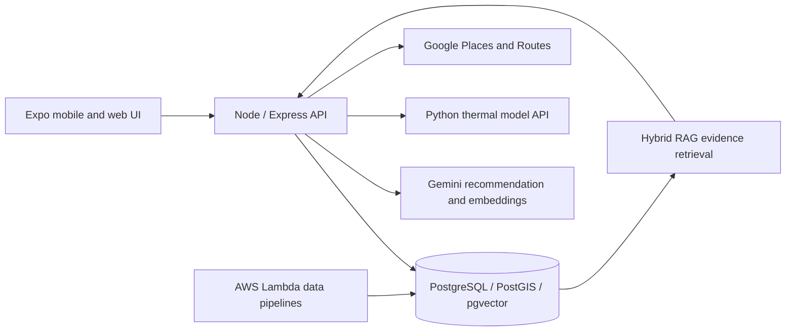
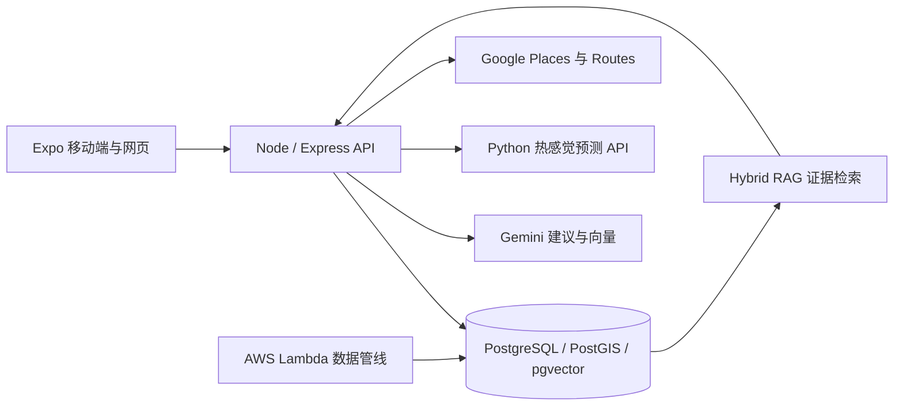

# SolAdapt — Melbourne Heat & UV Safety

An older-adult-focused app that turns local heat, UV, cooling places, and activity forecasts into practical outdoor decisions.


## Why it exists

Melbourne heatwaves and high UV can make routine trips harder for older adults. SolAdapt brings environmental conditions, nearby relief, route information, and plain-language guidance into one React Native/Expo experience. This repository is a final-code snapshot of a student team project, not a deployed public alert service.

## Core features

- **Heat and UV awareness:** alert cards and hourly environmental context help users recognise conditions before going out. Some alert states in this snapshot use development/demo data and thresholds; see [mobile notes](mobile/README.md).
- **Nearby cooling:** find shade, drinking fountains, and cooling options; view map results and walking routes through Google Maps/Routes integration.
- **Activity planning:** enter an activity, inspect the hourly forecast and thermal comfort prediction, and receive a Gemini-assisted recommendation with evidence and an alternative-time explanation.
- **Heat Smart Learning:** visual activities, scenarios, and quizzes teach everyday heat and sun safety.
- **Daily feedback reminder:** the planner can show a once-per-day prompt to record how an activity felt. This is an in-app feedback prompt, not a scheduled push notification.

## Screenshots

App captures are pending review. The intended gallery files are `assets/screenshots/home.png`, `assets/screenshots/cooling-map.png`, `assets/screenshots/activity-recommendation.png`, and `assets/screenshots/heat-smart-learning.png`; see [screenshot notes](assets/screenshots/README.md).


## Architecture



The API combines forecast values and deterministic timing logic with retrieved guidance chunks. Gemini writes explanatory recommendation fields; [Hybrid RAG](server/services/hybridRecommendation.js) keeps field-level deterministic fallbacks if retrieval or generation is unavailable. [RAG retrieval](server/services/ragRetrieval.js) queries the guidance index. The database schema and import scripts are in [database/](database/), while Lambda scripts fetch environmental data.

## Team project & my contribution

SolAdapt was built by a **six-person student team**. The rest of the SolAdapt team built other parts of the product; the contributions below describe my own work.

1. **Product planning:** I helped design heat and UV alerts, nearby cooling places, and safe route recommendations. I worked on user journey maps, information architecture, and user stories with acceptance criteria.
2. **AI features:** I independently built the Gemini API activity recommendation in [activityRecommendationLlm.js](server/services/activityRecommendationLlm.js), the retrieval and recommendation flow with field-level fallback in [hybridRecommendation.js](server/services/hybridRecommendation.js) and [ragRetrieval.js](server/services/ragRetrieval.js), and feature engineering and comparison experiments for thermal-sensation prediction in [ai/thermal_model/](ai/thermal_model/). The thermal model uses weather features such as temperature and humidity.
3. **UI redesign:** I independently rebuilt the web app's layout, visual style, and interactions across [screens](mobile/screens/), [components](mobile/components/), and [theme](mobile/theme/).
4. **Testing and iteration:** I reviewed prototypes and carried out exploratory checks focused on the recognisability of heat/UV warnings, map positioning, and information display.

## Project structure

```text
mobile/             Expo app, screens, components, themes, and tests
server/             Node API, recommendation services, and tests
ai/thermal_model/   Python prediction API, model, notebooks, and experiments
database/           PostgreSQL/PostGIS schema and import scripts
data/               Sample spatial data and validation scripts
docs/               Sanitized team notes and integration testing notes
assets/             Brand and home artwork; screenshot slots
```

## Run locally

1. Create PostgreSQL with the schema in [database/schema.sql](database/schema.sql) and load the datasets you need using the [database guide](database/README.md). The RAG path expects pre-populated `guidance_chunks` with embeddings.
2. Copy `server/.env.example` to `server/.env` and set database, Gemini, and Google API values. In `server/`, run `npm ci`, then `node index.js`; the default API port is **4000**. Run backend checks with `npm test`.
3. For thermal predictions, install the dependencies listed in `ai/thermal_model/requirements.txt` plus Flask, then run `python app.py` from `ai/thermal_model/`. The Python API listens on **5001** and loads `artifacts/experiment_5_historical_weather/selected_model.joblib`.
4. Copy `mobile/.env.example` to `mobile/.env`, set the API URL and Google Maps keys, run `npm ci` in `mobile/`, then `npm run web` or `npm run start` (Expo). For a physical device, set `EXPO_PUBLIC_API_BASE_URL` to a backend address reachable from that device.

Local functionality depends on database data and external API credentials. The saved artwork and code are included, while the four screenshot captures are still pending.

## Tech stack

React Native, Expo, React Native Web, Node.js, Express, PostgreSQL, PostGIS, pgvector, Python, Flask, scikit-learn, Gemini, Google Maps/Places/Routes, and AWS Lambda.

---

# SolAdapt — 墨尔本高温与紫外线安全助手

面向年长者，把本地高温、紫外线、附近避暑地点和活动预报转化为可执行的外出建议。


## 项目背景

墨尔本的热浪与强紫外线会增加年长者日常出行的难度。SolAdapt 在 React Native/Expo 界面中整合环境状况、附近降温资源、路线和易读建议。这是学生团队项目的最终代码快照，尚不是公开运营的预警服务。

## 核心功能

- **高温与紫外线提示：**警示卡片和逐小时环境信息帮助用户出门前识别风险。此快照中的部分警示状态使用开发演示数据与阈值，见[移动端说明](mobile/README.md)。
- **附近降温资源：**查找树荫、饮水点和其他降温地点，在地图查看结果，并结合 Google Maps/Routes 获取步行路线。
- **活动规划：**输入活动后查看逐小时预报、热舒适预测，以及结合 Gemini 和检索证据的活动建议与替代时间说明。
- **Heat Smart Learning：**通过图片活动、情境练习和测验学习高温及防晒常识。
- **每日反馈提醒：**活动规划页每天最多显示一次体感反馈提示；它是应用内弹窗，并非定时推送通知。

## 应用截图

截图待人工审阅后添加。预留文件为 `assets/screenshots/home.png`、`assets/screenshots/cooling-map.png`、`assets/screenshots/activity-recommendation.png` 和 `assets/screenshots/heat-smart-learning.png`；详情见[截图说明](assets/screenshots/README.md)。


## 系统架构



后端把预报数值、确定性的时间选择逻辑和检索到的指引片段结合起来。Gemini 生成解释性建议；[Hybrid RAG](server/services/hybridRecommendation.js)在检索或生成不可用时对字段采用确定性回退。[RAG 检索](server/services/ragRetrieval.js)查询指引索引。[database/](database/)包含数据库结构和导入脚本，Lambda 脚本负责获取环境数据。

## 团队项目与我的贡献

SolAdapt 由**六人学生团队**共同完成。SolAdapt 团队的其他成员负责项目的其他部分；以下仅描述我的工作。

1. **产品规划：**我参与设计高温与紫外线提醒、附近降温地点及安全路线建议，并制作用户旅程图、信息架构、用户故事和验收标准。
2. **AI 功能：**我独立实现 [activityRecommendationLlm.js](server/services/activityRecommendationLlm.js) 中的 Gemini 活动建议语言，以及 [hybridRecommendation.js](server/services/hybridRecommendation.js) 和 [ragRetrieval.js](server/services/ragRetrieval.js) 中带字段级回退的检索与建议流程；还在 [ai/thermal_model/](ai/thermal_model/)中完成热感觉预测的特征工程和对比实验，使用温度、湿度等天气特征。
3. **网页界面重设计：**我独立修改[页面](mobile/screens/)、[组件](mobile/components/)和[主题](mobile/theme/)代码，重建整个网页应用的布局、视觉风格和交互。
4. **测试与迭代：**我参与原型评审和探索性测试，重点检查高温/紫外线警示是否易识别、地图定位是否清楚，以及信息展示是否易读。

## 项目结构

```text
mobile/             Expo 应用、页面、组件、主题与测试
server/             Node API、推荐服务与测试
ai/thermal_model/   Python 预测 API、模型、Notebook 与实验
database/           PostgreSQL/PostGIS 结构与导入脚本
data/               示例空间数据与验证脚本
docs/               已清理的团队说明与集成测试说明
assets/             品牌和首页插画、截图占位
```

## 本地运行

1. 用 [database/schema.sql](database/schema.sql) 建立 PostgreSQL 数据库，再按[数据库说明](database/README.md)导入所需数据。RAG 流程还需要已写入向量的 `guidance_chunks`。
2. 把 `server/.env.example` 复制为 `server/.env`，填写数据库、Gemini 与 Google API 配置。在 `server/` 中运行 `npm ci`，再运行 `node index.js`；默认端口为 **4000**。后端检查使用 `npm test`。
3. 如需热感觉预测，安装 `ai/thermal_model/requirements.txt` 列出的依赖及 Flask，再从 `ai/thermal_model/` 运行 `python app.py`。Python API 监听 **5001**，并加载 `artifacts/experiment_5_historical_weather/selected_model.joblib`。
4. 把 `mobile/.env.example` 复制为 `mobile/.env`，设置 API 地址与 Google Maps 密钥，在 `mobile/` 中运行 `npm ci`，然后运行 `npm run web` 或 `npm run start`。在真机上，`EXPO_PUBLIC_API_BASE_URL` 必须是设备能够访问的后端地址。

本地完整功能依赖数据库数据和外部 API 凭据。代码与插画已包含，四张应用截图仍待补充。

## 技术栈

React Native、Expo、React Native Web、Node.js、Express、PostgreSQL、PostGIS、pgvector、Python、Flask、scikit-learn、Gemini、Google Maps/Places/Routes、AWS Lambda。
